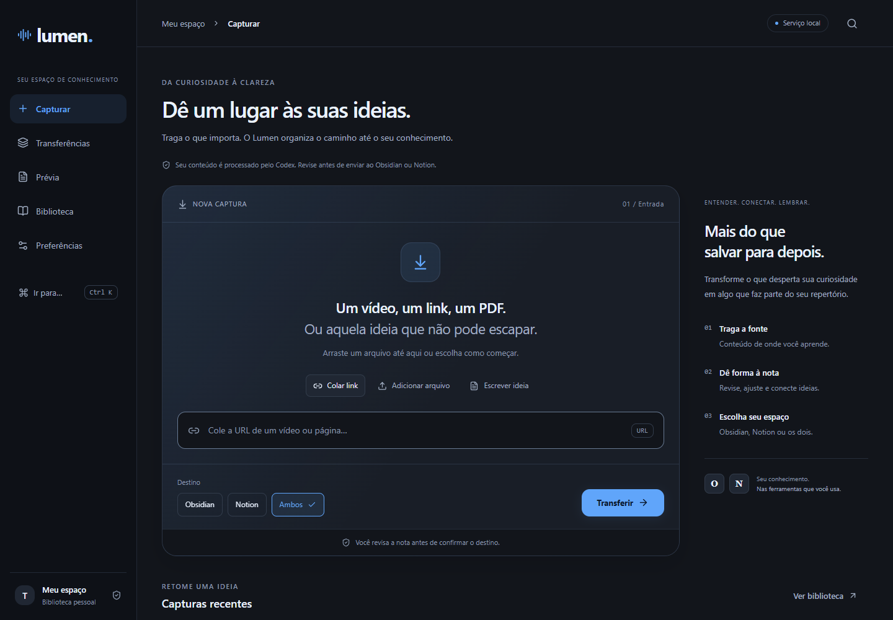

<div align="center">

# Lumen

### Bring content in. Keep knowledge moving.

Turn videos, links, PDFs and ideas into reviewed notes for Obsidian and Notion.

[**Explore Lumen →**](https://ArthurLAragao.github.io/lumen-organizer/) · [Install locally](#getting-started) · [Architecture](#project-map) · [Atlas](https://github.com/ArthurLAragao/atlas)




</div>

## A focused knowledge pipeline

1. **Capture** a YouTube URL, public link, text PDF, Markdown file or idea.
2. **Process** the source and generate a structured note using your configured Codex access.
3. **Review** the title, summary, tags, destination and generated content.
4. **Transfer** after confirmation, with history and per-destination publication receipts.

Capture, background transfers, editable preview, history and preferences share one
dark-first interface. Structural note validation does **not** mean the contents
have been fact-checked or that a study session is complete.

## Website versus application

**[GitHub Pages](https://ArthurLAragao.github.io/lumen-organizer/)** is the public
project showcase and installation guide. The working app runs **locally**, with a
React frontend and a Python loopback service. GitHub Pages cannot run Python,
access your local Obsidian vault or hold private Notion credentials.

The repository contains the real implementation, not simulated successful transfers.
Jarvis and its voice-provider integration are not part of this release.

## Getting started

Requirements: **Python 3.12+**, **Node.js 24+**, npm, and Windows with Edge or Comet
for the app window. The legacy Tk interface and tests need Tkinter. Codex CLI must
be installed and authenticated for AI generation. Availability and limits depend
on your account; this project includes no paid credits.

In PowerShell:

```powershell
git clone https://github.com/ArthurLAragao/lumen-organizer.git
cd lumen-organizer
python -m venv .venv
.\.venv\Scripts\python.exe -m pip install -r requirements.txt
npm --prefix frontend ci
npm --prefix frontend run build
```

Configure **your own** destinations before opening the application:

```powershell
$env:LUMEN_VAULT = 'C:\path\to\your\ObsidianVault'
$env:ATLAS_ROOT = 'C:\path\to\atlas'
$env:LUMEN_NOTION_LIBRARY_ID = 'your-notion-data-source-id'
$env:LUMEN_NOTION_LIBRARY_URL = 'https://www.notion.so/your-library'
.\.venv\Scripts\python.exe tools\open_interface.py
```

`ATLAS_ROOT` is only needed for the companion Atlas app; build Atlas first. Leave
Notion settings unset when using Obsidian only. The `.env.example` file documents
the variables; it is **not loaded automatically**. Variables above apply to that
PowerShell session. Persist them in your own Windows environment settings if needed.

Lumen opens at `http://127.0.0.1:43128`. The optional Atlas companion uses
`http://127.0.0.1:4180`. For a shortcut, target `.venv\Scripts\pythonw.exe`, pass
the absolute path to `tools\open_interface.py`, and set the working folder to the
repository. This starts the app without a development terminal.

### Notion setup

Connect Notion to your authenticated Codex installation. In your own workspace,
create a data source with `Título` (title), `Lumen ID` (text), `Fonte` (URL),
`Estado` (select including `Revisar`) and `Tipo` (select including `Vídeo`, `Link`,
`PDF`, `Markdown`, `Texto` and `Ideia`). Set its **data-source ID**, not a page ID,
in `LUMEN_NOTION_LIBRARY_ID`. Publication depends on that connection and schema.
No Notion API token is placed in the frontend.

## Supported content and limits

| Input                 | Notes                                                                          |
| --------------------- | ------------------------------------------------------------------------------ |
| YouTube               | Available captions in Portuguese or English are required.                      |
| Public links          | Server-rendered public text; authenticated/dynamic pages may need manual text. |
| PDF                   | Text PDFs only; scanned files need OCR first.                                  |
| Markdown, text, ideas | UTF-8 input, editable before publication.                                      |

Files are limited to **20 MB**, PDFs to **300 pages**, and extracted text to
**240,000 characters**. Sources exceeding limits are rejected instead of silently
truncated. Source content is untrusted; review generated notes before sending.
Uncertain deliveries require checking the destination before retrying.

## Verify locally

```powershell
npm --prefix frontend run typecheck
npm --prefix frontend run build
.\.venv\Scripts\python.exe tools\run_tests.py
python scripts/check_site.py
```

Hosted CI runs `tools/run_tests.py --headless`: interactive Tk cases are reported
as skipped because GitHub's Windows display is fixed and non-interactive. Use the
default command above for the complete local desktop suite.

The automated suite uses fictional notes and isolated destinations. It does not
prove that a different person's Codex/Notion account or physical device is configured.

## Project map

```text
frontend/              React interface, typed service contracts and design tokens
src/lumen_organizer/   Python capture, validation, safe import, history and runtime
tools/                Desktop entry points and test runner
tests/                Regression checks with fictional material
site/                 Static public showcase; no credentials or user notes
docs/                 Usage, architecture and historical verification
.github/workflows/    Checks and GitHub Pages deployment
```

Local state lives in `.local/` and browser storage. Vaults, captured material,
credentials, local paths and transfer histories are excluded from publication.
Public defaults are portable; no personal Notion library is bundled.

## Documentation

- [Frontend](frontend/README.md) · [Capture and publication](docs/CAPTURE-WORKSPACE.md)
- [Original validator and import documentation](docs/IMPLEMENTATION-NOTES.md)
- [Publishing and verification](docs/PUBLISHING.md)
- [Contributing](CONTRIBUTING.md) · [Security](SECURITY.md)

The source is public. No repository-wide open-source license has been assigned yet;
publication alone does not grant an additional license. Dependencies retain their
respective licenses.
